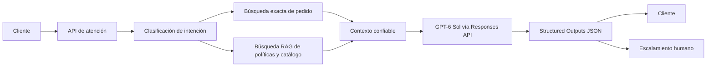

# Fase 1 - Selección y justificación del modelo de IA

## 1. Modelo seleccionado

### Elección principal: GPT-6 Sol

Se propone utilizar `GPT-6 Sol` como modelo principal mediante la **Responses API** de OpenAI.

La documentación oficial describe este modelo como una alternativa para equilibrar inteligencia y costo. Esta característica coincide con las necesidades de EcoMarket, que requiere atender un volumen alto de consultas sin sacrificar la calidad de las respuestas. La selección no se basa solamente en que el modelo pueda generar texto: se basa en su capacidad para integrarse dentro de una arquitectura controlada, consultar contexto empresarial y producir respuestas verificables.

EcoMarket necesita resolver dos problemas diferentes. El primero es operativo y exige precisión: conocer el estado real de un pedido, su fecha estimada y el enlace de seguimiento. El segundo es conversacional y exige comprensión del lenguaje: explicar una política de devolución, responder una pregunta sobre un producto o comunicarse con empatía cuando el cliente está inconforme. GPT-6 Sol es adecuado como modelo principal porque puede cubrir ambas necesidades siempre que la información operativa no dependa de la memoria del modelo, sino de fuentes recuperadas por el sistema.

La elección se justifica por los siguientes factores:

#### Arquitectura del modelo y adecuación al problema

GPT-6 Sol funcionará como la capa de generación de una arquitectura RAG híbrida. El modelo no será utilizado como una base de datos ni se le pedirá que recuerde los pedidos de EcoMarket. En cada consulta, el sistema recuperará la información pertinente y la entregará como contexto controlado.

Para los pedidos se utilizará una búsqueda exacta en una base estructurada. Esta decisión es importante porque un número de seguimiento no debe recuperarse por similitud aproximada: debe coincidir con un registro real. Para políticas, catálogo y preguntas generales se utilizará búsqueda semántica, porque los clientes pueden expresar la misma necesidad con palabras diferentes.

Esta división permite aprovechar las fortalezas del modelo sin delegarle decisiones que corresponden a otros componentes:

- La base de pedidos determina los hechos operativos.
- El recuperador selecciona la información relevante.
- GPT-6 Sol interpreta la consulta y redacta la respuesta.
- El backend valida el formato y aplica reglas de negocio.
- Un agente humano revisa casos complejos o ambiguos.

Por tanto, la arquitectura propuesta combina precisión determinista para los datos críticos con flexibilidad lingüística para la comunicación con el cliente.

#### Calidad y fluidez de las respuestas

El 20 % de las consultas de EcoMarket requiere un tratamiento más cuidadoso: quejas, problemas técnicos, sugerencias y situaciones donde el cliente espera empatía. Un sistema basado solamente en reglas o coincidencias de palabras podría identificar el tema, pero tendría dificultades para explicar una decisión de manera natural.

GPT-6 Sol puede transformar el contexto recuperado en una respuesta clara, breve y adaptada a la situación. Por ejemplo, puede informar que un producto de higiene abierto no es elegible para devolución y, al mismo tiempo, explicar la razón con respeto y ofrecer los pasos disponibles. Esta capacidad de redacción es relevante para la satisfacción del cliente, pero siempre debe estar limitada por la política recuperada.

La calidad esperada no se medirá por respuestas largas o creativas. Se medirá por cuatro condiciones: que la respuesta sea correcta, que se fundamente en una fuente, que tenga el tono apropiado y que reconozca cuando no puede resolver el caso.

#### Precisión y reducción de alucinaciones

Un LLM puede generar una respuesta plausible aunque el dato no exista. Este riesgo es especialmente grave en consultas de pedidos, porque un estado inventado o una fecha falsa puede generar costos, reclamos y pérdida de confianza.

Por eso, GPT-6 Sol se integrará con RAG y no trabajará de forma aislada. El prompt indicará que solo puede utilizar la información incluida en el contexto. Si el número de seguimiento no aparece, la respuesta correcta será informar que no se encontró y solicitar verificarlo. El modelo no deberá completar el dato por inferencia.

Además, la salida se validará con Structured Outputs y con modelos de datos en Python. La validación comprobará que existan campos como `encontrado`, `estado`, `fecha_estimada` y `requiere_agente`. Si la respuesta no cumple el esquema o contradice una regla, no se enviará directamente al cliente.

#### Costo

El costo debe analizarse junto con el volumen de EcoMarket. Debido a que el 80 % de las consultas es repetitivo, no sería conveniente utilizar el modelo de mayor capacidad para cada solicitud. GPT-6 Sol representa un equilibrio entre calidad y costo para utilizar un solo modelo durante la primera versión del proyecto.

El costo puede controlarse mediante varias decisiones de arquitectura:

- Recuperar solo los fragmentos necesarios en lugar de enviar documentos completos.
- Limitar la longitud de las respuestas.
- Reutilizar respuestas para preguntas frecuentes cuando sea seguro.
- Usar reglas y consultas SQL antes de llamar al modelo.
- Reservar una posible arquitectura futura con GPT-6 Luna para consultas simples.
- Escalar a un modelo de mayor capacidad solo en casos excepcionales.
- Medir tokens, latencia y costo por conversación.

GPT-6 Astra se considera una alternativa de mayor capacidad para casos muy complejos, pero su uso como modelo único sería difícil de justificar económicamente para el 80 % de consultas rutinarias. GPT-6 Luna podría reducir costos en tareas muy estructuradas, pero GPT-6 Sol ofrece un mejor punto de partida para cubrir simultáneamente consultas operativas, preguntas ambiguas y respuestas empáticas.

#### Escalabilidad

La solución debe soportar el crecimiento de EcoMarket sin rediseñar todo el sistema. La escalabilidad se logrará separando los componentes:

- La API puede ejecutarse en varias instancias.
- La base de pedidos puede crecer de SQLite a PostgreSQL.
- La base vectorial puede incorporar nuevos documentos sin reentrenar el modelo.
- La cola de agentes puede recibir automáticamente los casos escalados.
- El proveedor de modelos puede cambiarse mediante una capa de cliente.

La arquitectura también permite clasificar las consultas antes de llamar al LLM. Las preguntas que puedan resolverse con una consulta estructurada no deben consumir más contexto del necesario. Esto reduce latencia y costo, y permite que el modelo se concentre en las tareas donde aporta mayor valor.

#### Facilidad de integración

OpenAI proporciona un cliente para Python y una Responses API para nuevas aplicaciones de generación de texto. La integración puede encapsularse en un módulo independiente, de manera que el resto del sistema no dependa directamente de detalles del proveedor.

La aplicación se organizará en capas:

1. FastAPI recibe la solicitud.
2. Pydantic valida los datos de entrada.
3. El módulo de recuperación consulta pedidos o documentos.
4. El módulo de prompts construye las instrucciones y el contexto.
5. El cliente de OpenAI envía la solicitud a GPT-6 Sol.
6. Pydantic valida la respuesta estructurada.
7. Las reglas de negocio deciden si se responde o se escala.

Esta separación facilita las pruebas, el mantenimiento y el reemplazo futuro del modelo. También evita que la clave de API o la lógica de negocio queden mezcladas con los prompts.

#### Actualización de la información

Los estados de pedidos y las políticas de devolución pueden cambiar después del entrenamiento del modelo. Por esta razón, el sistema debe recuperar la información en tiempo de consulta.

Con RAG, actualizar un pedido implica actualizar el registro correspondiente. Actualizar una política implica modificar el documento y volver a indexarlo. No es necesario volver a entrenar GPT-6 Sol, lo cual reduce tiempo, costo y riesgo operativo.

El fine-tuning podría considerarse en el futuro para adaptar el estilo o una tarea muy específica, pero no es apropiado como mecanismo principal para mantener datos que cambian con frecuencia.

#### Salida estructurada e integración con sistemas empresariales

El asistente no solo debe producir texto para una persona. También debe entregar información que pueda procesar el backend. Por eso se solicitará una respuesta JSON con campos definidos.

Para una consulta de pedido, la estructura puede incluir:

```json
{
    "encontrado": true,
    "numero_seguimiento": "ECO-10001",
    "estado": "En tránsito",
    "fecha_estimada": "2026-09-25",
    "enlace_rastreo": "https://tracking.example.com/ECO-10001",
    "mensaje_cliente": "Su pedido está en tránsito.",
    "requiere_agente": false,
    "fuentes": ["sistema_pedidos"]
}
```

Esta estructura permite que una interfaz web, un chatbot o un sistema de tickets utilicen la respuesta sin tener que interpretar texto libre. También facilita registrar la fuente, medir errores y activar el escalamiento humano.

#### Seguridad y privacidad

La facilidad de integrar un modelo externo no elimina las responsabilidades sobre los datos de los clientes. El sistema debe aplicar minimización de datos: enviar solo la información necesaria para resolver la consulta.

Las direcciones, correos, teléfonos e historiales de compra no deben incluirse en el contexto si no son necesarios. Los identificadores internos pueden separarse de la información que se muestra al cliente. La clave de API debe almacenarse como variable de entorno y nunca incluirse en el repositorio.

También se deben revisar las políticas vigentes de OpenAI sobre uso, retención y tratamiento de datos antes de una implementación productiva. La arquitectura documental no asume que una API externa sustituya las políticas de privacidad de EcoMarket.

#### Adecuación al caso de negocio

La selección responde directamente al problema descrito:

- Reduce el tiempo de respuesta de 24 horas mediante automatización de consultas repetitivas.
- Puede cubrir gran parte del 80 % de solicitudes frecuentes.
- Mantiene respuestas fluidas para preguntas generales.
- Permite consultar datos exactos de pedidos.
- Actualiza políticas y catálogo sin reentrenamiento.
- Deriva el 20 % de casos complejos a agentes humanos.
- Convierte a los agentes en supervisores y especialistas de casos difíciles.

La propuesta no promete que el modelo resuelva todos los casos. Su valor está en automatizar con control las tareas de alto volumen y reservar la intervención humana para las situaciones donde el lenguaje, la empatía, la autorización o el criterio empresarial son indispensables.

## 2. Modelos considerados

### GPT-6 Astra

Es el modelo de mayor capacidad de la familia presentada en la documentación oficial. Puede ser apropiado para problemas de razonamiento muy complejos, pero no es la mejor elección como modelo único para EcoMarket porque:

- Su costo es mayor.
- La mayoría de las consultas no necesita razonamiento avanzado.
- Usarlo para el 80 % de preguntas repetitivas sería poco eficiente.

Podría reservarse para una segunda etapa de escalamiento, por ejemplo, en investigaciones complejas o análisis de quejas de alto impacto.

### GPT-6 Luna

Está orientado a tareas enfocadas y de alto volumen con menor costo. Puede ser una buena alternativa para consultas muy simples como:

- Estado de un pedido.
- Preguntas frecuentes.
- Consulta de una regla directa.

Sin embargo, para este taller se prefiere `GPT-6 Sol` como modelo único porque EcoMarket también necesita responder preguntas ambiguas, redactar con empatía y manejar excepciones de devoluciones.

En una optimización futura se podría utilizar un enrutador:

```text
Consulta repetitiva y estructurada -> GPT-6 Luna
Consulta ambigua o compleja -> GPT-6 Sol
```

Esta optimización no es necesaria para demostrar el taller y se deja como trabajo futuro.

## 3. Por qué no fine-tuning como primera alternativa

No se propone comenzar con fine-tuning porque los datos principales de EcoMarket cambian con frecuencia:

- El estado de un pedido cambia en tiempo real.
- Las políticas pueden modificarse.
- El catálogo se actualiza.
- Las condiciones de envío pueden cambiar por región.

El fine-tuning puede ayudar a adaptar estilo, clasificación o formato, pero no debe usarse como sustituto de una base de datos actualizada. Para este caso, RAG permite modificar la información fuente sin reentrenar el modelo completo.

## 4. Arquitectura propuesta



## 5. Principio de separación de responsabilidades

El modelo no será la fuente primaria de verdad.

- El sistema de pedidos determina el estado real de un pedido.
- La base de conocimiento contiene políticas y características de productos.
- El recuperador selecciona la información relevante.
- GPT-6 Sol interpreta el contexto y redacta la respuesta.
- El backend valida la salida y aplica reglas de negocio.
- Un agente humano interviene cuando la automatización no es suficiente.

Esta separación reduce el riesgo de que el modelo invente datos operativos.

## 6. Uso de la Responses API

La implementación futura debe utilizar la Responses API, recomendada actualmente por OpenAI para nuevas aplicaciones de generación de texto.

El prompt se separará en:

- `instructions`: reglas del asistente, tono, límites y políticas.
- `input`: consulta del cliente y contexto recuperado.
- Herramientas o funciones: operaciones controladas como buscar pedido.
- Structured Outputs: esquema JSON que el modelo debe producir.

La información recuperada debe tratarse como datos. No debe permitirse que un texto de un documento modifique las reglas principales del sistema.

## 7. Criterios de aceptación de la elección

La elección se considera justificada si el sistema logra:

1. Responder correctamente al menos los casos de pedidos existentes.
2. No inventar un pedido inexistente.
3. Identificar productos no retornables según la política.
4. Producir JSON válido.
5. Mantener un tono claro y empático.
6. Escalar casos ambiguos o complejos.
7. Registrar la fuente de la información usada.

## 8. Conclusión de la Fase 1

La solución recomendada es un sistema híbrido de RAG con `GPT-6 Sol` como LLM principal, búsqueda exacta para pedidos y recuperación semántica para documentos empresariales.

La implementación práctica mantiene esa misma elección para todos los flujos: estado del pedido, devoluciones, consulta de producto, política y triage. Las capacidades adicionales no representan un cambio de modelo, sino extensiones del mismo diseño base para cubrir más escenarios de soporte con la misma arquitectura de control y salida estructurada.

Esta alternativa tiene un mejor equilibrio que un modelo local pequeño o un modelo de máxima capacidad utilizado para todas las consultas. Es escalable y actualizable, y permite combinar la precisión de los sistemas estructurados con la fluidez de un LLM.
