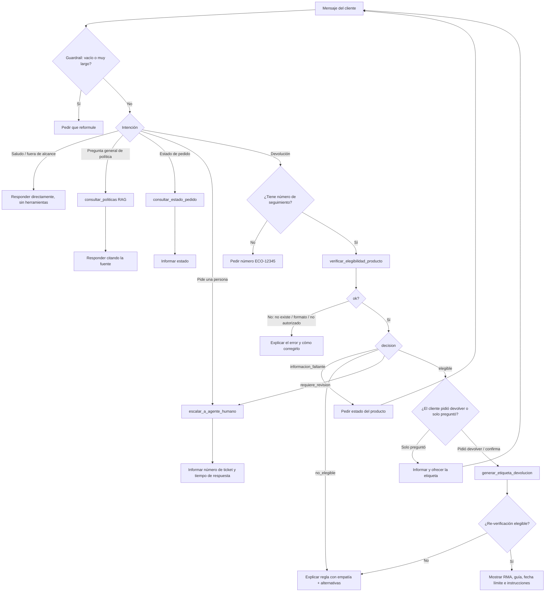

# Proyecto final - Fase 1: diseño de la arquitectura del agente

## Objetivo

El asistente de EcoMarket deja de solo responder preguntas y pasa a ejecutar el
proceso de devolución: verifica si un producto puede devolverse y, si procede,
genera la etiqueta de devolución. El RAG del Taller 2 se conserva para las
preguntas generales sobre políticas.

## Extensión de la arquitectura RAG

Se evaluaron las dos opciones que propone el enunciado:

| Opción | Ventaja | Desventaja |
| --- | --- | --- |
| **RAG como herramienta del agente (seleccionada)** | El LLM decide en un solo lugar si necesita políticas, datos de un pedido o una acción. Una conversación puede combinar ambas cosas («¿cuál es el plazo? y quiero devolver ECO-10013») | Cada consulta de política pasa por el ciclo de razonamiento del agente |
| RAG como ruta alterna (router) | Las preguntas de política no consumen pasos de agente | Hay que mantener un clasificador de intención y coordinar dos rutas |

La solución combina ambas ideas en dos niveles:

1. **Modo principal, agente LLM.** LangChain `create_agent` con GPT-6 Sol y cinco
   herramientas. El RAG es la herramienta `consultar_politicas`, que reutiliza la
   clase `KnowledgeBase` (Chroma + embeddings multilingües) del Taller 2.
2. **Modo de respaldo, router por reglas.** Si no hay credenciales de OpenAI, la
   credencial es inválida o el LLM falla, un router determinista detecta la
   intención por palabras clave y llama a las mismas herramientas. Es la
   «arquitectura router» del enunciado y evita que el servicio quede caído.

Como las reglas de negocio viven dentro de las herramientas y no en el prompt,
ambos modos toman la misma decisión de elegibilidad para el mismo caso.

```text
Usuario (Streamlit / POST /api/agent/chat)
   │
   ▼
Guardrail de entrada (vacío, longitud máxima)
   │
   ├── LLM disponible ──► Agente LangChain (GPT-6 Sol)
   │                         │  decide: responder directo o llamar herramientas
   │                         ▼
   │                      Herramientas ──► sistemas simulados + RAG (Chroma)
   │                         │
   │                      Respuesta redactada por el LLM
   │
   └── sin LLM / error ──► Router por reglas ──► mismas herramientas ──► plantillas
   │
   ▼
Bitácora JSONL (runtime/agent_actions.jsonl) + métricas
```

## Definición de las herramientas

Además del RAG, el agente usa cuatro herramientas; el enunciado exige al menos
dos. Están en `src/agent_tools.py`. Todas devuelven la misma envoltura JSON:

```json
{"ok": true, "codigo": "ELEGIBLE", "mensaje": "texto legible", "...": "datos"}
```

Un error esperado (pedido inexistente, formato inválido, no autorizado) se
devuelve con `"ok": false` y un `codigo`, no como excepción. Así el LLM puede
explicárselo al cliente sin interrumpir la conversación.

| Herramienta | Entrada | Salida | Sistema simulado |
| --- | --- | --- | --- |
| `verificar_elegibilidad_producto` | `numero_seguimiento`, `estado_producto` (`nuevo_sin_uso`, `abierto_o_usado`, `defectuoso`, `danado_en_envio`, `desconocido`), `motivo` | `decision` (`elegible`, `no_elegible`, `requiere_revision`, `informacion_faltante`), `regla_aplicada`, `dias_desde_entrega`, `pasos_siguientes`, `requiere_agente`, `fuentes` | Pedidos (`data/pedidos.json`), catálogo y reglas de la política |
| `generar_etiqueta_devolucion` | Las mismas que la anterior | `etiqueta` con `numero_rma`, `guia_devolucion`, `url_etiqueta`, `valida_hasta`, instrucciones; o `NO_ELEGIBLE_PARA_ETIQUETA` | Logística inversa (`runtime/estado_devoluciones.json`) |
| `consultar_estado_pedido` | `numero_seguimiento` | `pedido` con estado, fecha, transportadora, enlace y días desde la entrega | Pedidos |
| `escalar_a_agente_humano` | `motivo`, `numero_seguimiento` opcional | `numero_ticket`, `prioridad`, `tiempo_respuesta_estimado` | Mesa de ayuda (mismo JSON de estado) |
| `consultar_politicas` (RAG) | `pregunta`, `categoria` opcional (`devoluciones`, `envios`, `garantias`) | `fragmentos` con `fuente` y `contenido`, `fuentes` | Chroma del Taller 2 |

### Reglas de elegibilidad

`verificar_elegibilidad_producto` aplica, en este orden, las reglas de
`data/politica_devoluciones.pdf` y `data/politica_garantias.json`:

1. Un motivo que menciona lesiones, alergias, disputas legales o compensaciones
   da `requiere_revision`, porque la política exige escalar esos casos.
2. Un pedido cancelado, devuelto o aún no entregado da `no_elegible`.
3. Pasados más de 30 días desde la entrega, el resultado es `no_elegible`. La
   excepción es un producto defectuoso dentro de los 90 días de garantía: da
   `requiere_revision` y se piden evidencias.
4. Si el cliente no indicó el estado del producto, el resultado es
   `informacion_faltante`. El agente no debe suponerlo.
5. Un producto personalizado solo se devuelve con defecto comprobado, y esa
   revisión la hace una persona.
6. Los productos perecederos solo se devuelven con daño o defecto.
7. Un producto de higiene abierto da `no_elegible`, salvo defecto de fabricación.
8. Un producto abierto o usado de otra categoría da `no_elegible`.
9. Un producto defectuoso o dañado dentro del plazo da `elegible` y se piden
   evidencias. Un producto nuevo y sin uso dentro del plazo da `elegible`.

La fecha de cálculo sale de `AGENT_REFERENCE_DATE`, o de la fecha del sistema si
esa variable no está definida. Fijarla en `2026-10-27` hace reproducible la
demostración con los datos de ejemplo.

### Por qué la decisión no la toma el LLM

En el Taller 2, `/api/returns/evaluate` le pedía al modelo decidir la
elegibilidad. Ahora el agente puede ejecutar una acción con efecto (emitir una
etiqueta), así que la regla se codificó de forma determinista:

- Es auditable: cada decisión trae la `regla_aplicada`.
- Es repetible: el mismo caso siempre da el mismo resultado.
- `generar_etiqueta_devolucion` vuelve a verificar la elegibilidad antes de
  emitir. Aunque el LLM se salte el paso de verificación, por una alucinación o
  por *prompt injection*, no se emite una etiqueta indebida.

El LLM queda a cargo de lo que hace bien: interpretar el lenguaje del cliente,
extraer el número de seguimiento y el estado del producto, decidir qué
herramienta usar y redactar la respuesta.

### Contexto de sesión y autorización

El `customer_id` lo fija la sesión (selector de cliente en Streamlit o el campo
`customer_id` de la API) y se inyecta en las herramientas desde el servidor. No
es un argumento que el LLM pueda elegir. Si el pedido no pertenece al cliente de
la sesión, la herramienta responde `NO_AUTORIZADO` sin revelar datos del pedido.

## Selección del marco de agentes: LangChain

| Criterio | LangChain (`create_agent`) | LlamaIndex (`FunctionAgent`) |
| --- | --- | --- |
| Continuidad con el Taller 2 | El RAG ya usa `langchain-chroma`, `langchain-huggingface` y `langchain-text-splitters`; el retriever se reutiliza sin adaptadores | Habría que envolver Chroma o reindexar con las abstracciones de LlamaIndex |
| Definición de herramientas | `StructuredTool` + esquema Pydantic: los `Literal` (estado del producto, categoría) llegan al LLM como enumeraciones | `FunctionTool` equivalente |
| Bucle de agente | `create_agent` (sobre LangGraph) gestiona el ciclo razonar → herramienta → observar, con `recursion_limit` para cortar bucles | Equivalente; su fortaleza principal es la indexación y consulta de documentos |
| Pruebas | Acepta cualquier `BaseChatModel`; las pruebas usan un modelo falso que emite *tool calls* sin red | Posible, con menos ejemplos para este patrón |

**Decisión:** LangChain. El proyecto ya depende de su ecosistema, la integración
de herramientas con esquemas Pydantic es directa y el flujo es más de acciones
que de indexación documental, que es donde LlamaIndex aporta más. Versiones
usadas: `langchain 1.4`, `langchain-openai 1.7`.

## Flujo de trabajo del proceso de devolución



Hay dos decisiones del agente que conviene destacar:

- **Preguntar frente a actuar.** «¿Puedo devolver…?» solo verifica la
  elegibilidad y ofrece la etiqueta. «Quiero devolver…» verifica y genera la
  etiqueta. La acción con efecto ocurre solo cuando el cliente la pidió o la
  confirmó.
- **No suponer datos.** Si falta el estado del producto, el agente lo pregunta
  en vez de inferir «nuevo», que llevaría a aprobar devoluciones indebidas.
